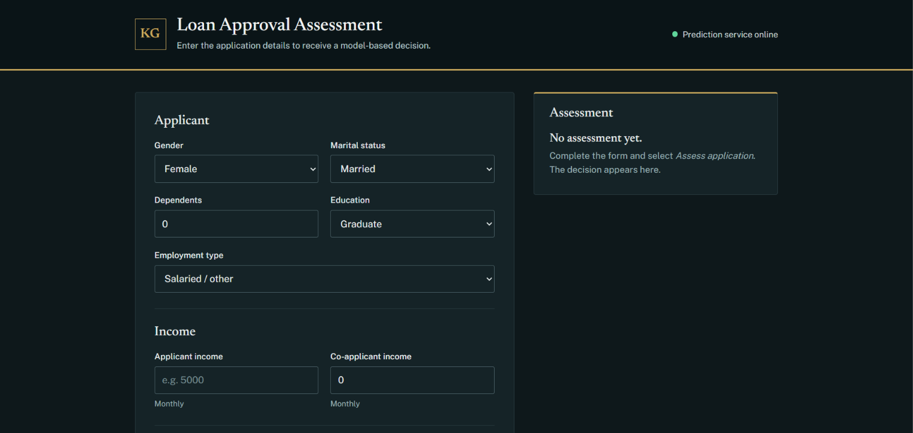
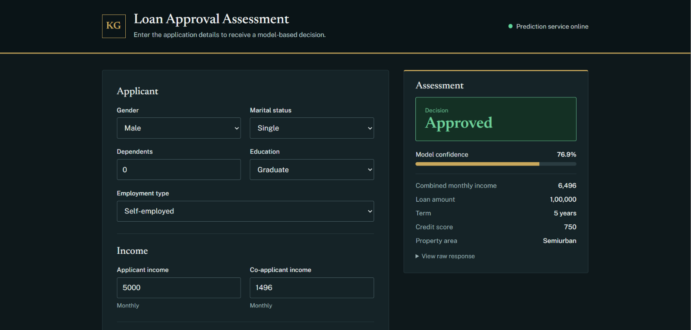
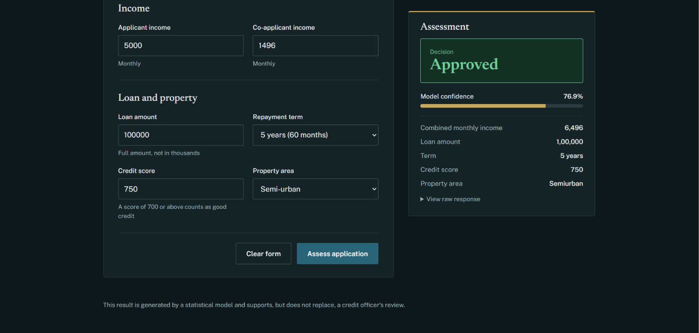
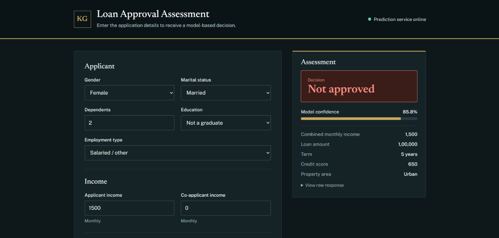
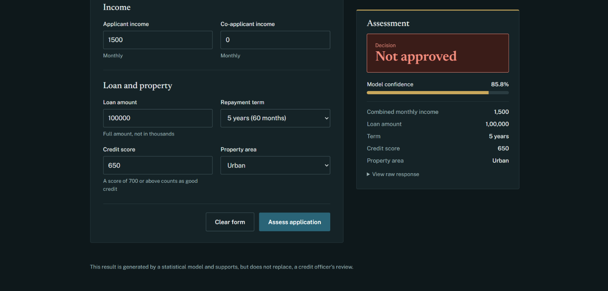
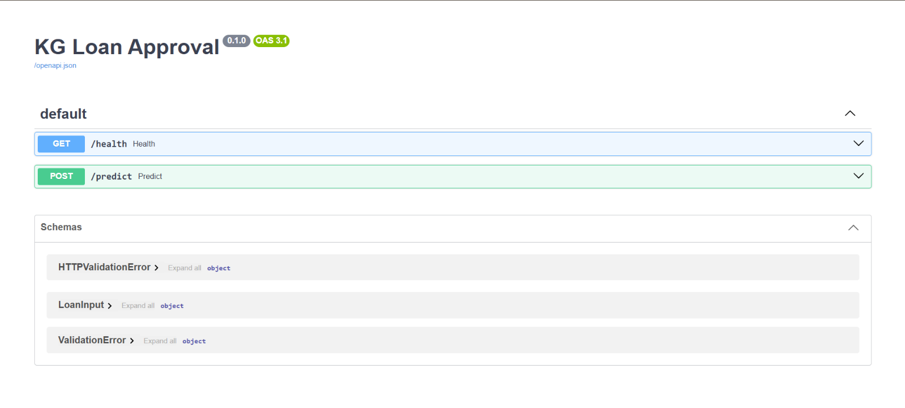

# KG Loan Approval Prediction System

An end-to-end machine learning project that predicts whether a loan application is likely to be approved. A Logistic Regression model is served through a FastAPI backend, and a web interface lets users enter an application and see the decision with a confidence score. The API and UI are deployed together as one service.

**Live demo:** https://kg-loan-approval.onrender.com

## Screenshots

### Application form


### Approved result



### Not approved result




## Features

- Predicts loan approval from 11 applicant and loan details
- Returns the decision (Approved / Not approved) and the model's confidence
- Input validation in both the web form and the API
- Responsive web interface served by the same FastAPI app (single deployment)
- Interactive API documentation at `/docs`

## How it works

1. **Data preparation:** exploratory analysis and preprocessing (missing values, encoding, feature engineering) are in `KG_Loan_Data_Preperation/`.
2. **Modeling:** features are scaled with `StandardScaler` and a Logistic Regression model is trained and evaluated in `KG_Modeling/`. The fitted scaler and model are saved to `KG_Loan_Artifacts/`.
3. **Prediction:** `KG_Loan_Predict_Module.py` applies the same encoding and scaling to new input and returns the prediction and confidence score.
4. **API and UI:** `KG_Loan_Predict_API.py` exposes `/predict` and `/health` and serves the web UI from `KG_Loan_UI/`.

## Model performance

| Metric    | Score  |
|-----------|--------|
| Accuracy  | 0.86   |
| Precision | 0.84   |
| Recall    | 0.98   |
| F1-score  | 0.90   |
| ROC-AUC   | 0.84   |

## Input fields

| Field | Description |
|-------|-------------|
| Gender | Female / Male |
| Marital status | Married / Single |
| Dependents | Number of dependents (3 or more treated as 3) |
| Education | Graduate: Yes / No |
| Employment | Self-employed: Yes / No |
| Applicant income | Monthly income |
| Co-applicant income | Monthly income (0 if none) |
| Loan amount | Full amount requested |
| Term | Repayment term in months |
| Credit score | 300–900 (700 or above counts as good credit) |
| Property area | Urban / Semiurban / Rural |

## Project structure

```
KG_Loan_Approval/
├── KG_Loan_Artifacts/           Dataset, trained model and scaler
├── KG_Loan_Data_Preperation/    EDA and preprocessing notebooks
├── KG_Modeling/                 Model training notebook
├── KG_Loan_UI/                  Web interface (HTML, CSS, JS)
├── KG_Loan_Predict_API.py       FastAPI app (API + UI)
├── KG_Loan_Predict_Module.py    Prediction function
├── requirements.txt
└── render.yaml                  Render deployment config
```

## Run locally

```bash
pip install -r requirements.txt
uvicorn KG_Loan_Predict_API:app --port 8000
```

Then open `http://localhost:8000` for the UI, or `http://localhost:8000/docs` for the API docs.

## API

**Live demo:** https://kg-loan-approval.onrender.com/docs

### API documentation


`POST /predict` returns:

```json
{ "Prediction": 1, "Confidence_score": 87.5 }
```

`1` means approved and `0` means not approved. `GET /health` returns the service status.

## Tech stack

Python, pandas, NumPy, scikit-learn, joblib, FastAPI, Uvicorn, Pydantic, HTML/CSS/JavaScript, Render

## Disclaimer

This is a statistical model built for learning and demonstration. Its output is not a lending decision and should not replace a credit officer's review.